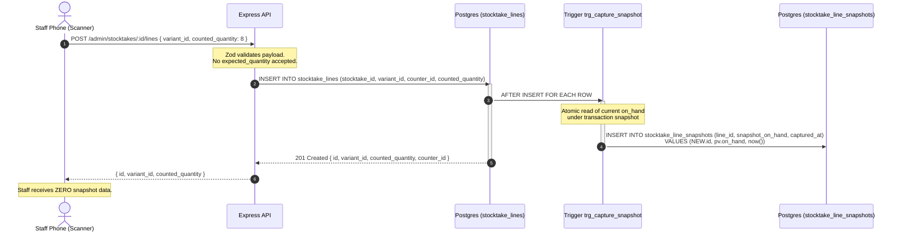

# M2b Design Note: Stocktake, The Opening Count, Concurrency, and Shrinkage

**Status:** Proposed for Architecture Review  
**Author:** Antigravity  
**Target Branch:** `m2b/stocktake`  
**Reference Specs:** `docs/tasks/warehouse-m2b-stocktake.md`, `prompts/m2b-design.md`, `.agents/rules/inventory.md`, `docs/design-notes/m2a-receiving-cost.md`, `docs/audits/m2a-fix-notes.md`  
*(Length justification: Detailed SQL DDL specifications for 5 tables, tamper-proof snapshot trigger, complete atomic posting RPC `post_stocktake`, variance query with indexes, multi-counter conflict resolution algebra, mathematical analysis of concurrent delta composition, rigorous RLS and PostgREST security isolation matrices, and zero-downtime migration/rollback strategy).*

---

## 1. Direct Answers to §10 Open Questions

### Q1. System On-Hand Snapshot Capture, Storage, and Tamper-Proofing
- **Where Captured and Stored:**  
  The snapshot is captured inside the database engine via an `AFTER INSERT` trigger (`trg_capture_stocktake_line_snapshot`) running with `SECURITY DEFINER` privileges. It is stored in a dedicated, admin-only table: `public.stocktake_line_snapshots(line_id, snapshot_on_hand, captured_at)`.
- **Guarantee against Client Tampering or Supplying:**  
  1. *Schema Isolation:* The client-facing table `stocktake_lines` does **not** have a `snapshot_on_hand` or `expected_quantity` column. A client literally cannot supply it because the column does not exist on the writable table. Zod schema validation on the Express API strips any unexpected attributes.
  2. *Trigger Authority:* The trigger reads `product_variants.on_hand` at the microsecond the count line is inserted into Postgres and writes directly to `stocktake_line_snapshots`.
  3. *RLS Secrecy:* `stocktake_line_snapshots` is protected by `public.is_admin()`. Staff tokens querying PostgREST receive 0 rows, completely preventing staff from discovering what the system expected.

### Q2. Posting Atomicity Across 500 Lines and Failure Semantics
- **Atomicity Boundary:**  
  Atomicity lives entirely within a single PostgreSQL ACID transaction inside the database RPC `post_stocktake(p_stocktake_id, p_actor_id)`.
- **No Client-Side Batching:**  
  A 500-line post must **not** be broken into multiple HTTP requests or partial database commits. In Postgres, inserting 500 movement rows and executing the `BEFORE INSERT` trigger (`trg_apply_stock_movement`) takes ~15–30 ms. Splitting into batches would introduce catastrophic partial-failure states where a count is half-committed and un-rollbackable.
- **What Happens if Line 300 Fails:**  
  If line 300 fails (e.g. invariant violation, foreign key constraint, or `ST001` insufficient stock when `allow_negative_stock = false`):
  1. The entire PostgreSQL transaction automatically **aborts and rolls back**.
  2. Zero rows are inserted into `stock_movements`.
  3. `product_variants.on_hand` is untouched for all 500 items.
  4. `stocktakes.status` remains `'draft'`.
  5. The RPC raises an actionable exception identifying the exact variant SKU, line number, and reason for failure.

### Q3. Cost Basis for Found and Lost Units, Posting Dates, and Replay Interaction
- **Cost Basis Formulation:**
  - **Lost Unit (`quantity_delta < 0`, Shrinkage):** Valued at the variant's prevailing moving weighted-average cost (`running_avg_cost`). As an outbound physical loss, it consumes inventory cost basis without changing the unit average cost of remaining stock.
  - **Found Unit (`quantity_delta > 0`, Surplus):** Absorbed into inventory at the prevailing moving weighted-average cost (`running_avg_cost`). This prevents false margin dilution: absorbing found units at $0 would artificially depress the running average and fabricate phantom profits on future sales. If the variant has zero cost basis (unvalued opening stock), it enters at $0 and retains `has_unknown_cost_basis = true`.
- **Replay Interaction and `posting_date`:**
  - Corrections are posted with `sm.posting_date = v_stocktake.posting_date` (the operational timestamp of the stocktake, defaulting to the time of posting).
  - Because lost and found units are valued at the prevailing average cost at that moment, replaying from that date forward leaves historical sales in prior periods untouched. Closed period margins and historical COGS are permanently preserved.

### Q4. Concurrent Counting by Three Staff: Ownership, Duplicates, and Conflict Surfacing
- **Ownership:**  
  Each count line carries `counter_id = auth.uid()`. While the stocktake is in `draft`, staff can edit or delete their own lines (e.g. fixing a typo). Staff cannot edit or delete lines created by other counters.
- **Duplicate Variants:**  
  Multiple staff can scan the same variant (e.g. Ali counts 5 on the front shelf at 14:00; Samir counts 10 in the back store room at 14:30). Both lines are recorded without database locking conflicts.
- **Conflict Surfacing & Resolution:**  
  The variance review groups lines by `variant_id`. When `COUNT(line_id) > 1`, a conflict badge is raised. In the review screen, the owner chooses the resolution:
  1. `sum`: Additive locations (e.g. 5 on shelf + 10 in backroom = 15 total counted).
  2. `override`: Replace/recount (e.g. Samir's recount supersedes Ali's count).
  Posting is strictly blocked until all duplicate variants have an explicit resolution recorded in `stocktake_resolutions`.

### Q5. Reserving or Freezing Inventory
- **Decision:** **A stocktake reserves NOTHING and freezes NOTHING.**
- **Reasoning:**
  1. *Operational Requirement:* The shop stays open and trades during counting (~50–100 sales/day). Freezing checkout halts revenue and was the primary reason the merchant abandoned their previous software.
  2. *Domain Invariant:* `.agents/rules/inventory.md` mandates that reservations are not movements and do not change physical presence.
  3. *Mathematical Soundness:* Because delta corrections $(\Delta = C - S)$ isolate the discrepancy at observation time, sales occurring before or after posting land on top and compose cleanly without collision.
- **Enforcement:** No lock column, reservation status, or freeze predicate exists in the schema or checkout endpoints.

### Q6. Variance Query Shape and Indexes
- **Query Architecture:** A single read-only CTE joining `stocktakes`, `stocktake_lines`, `stocktake_line_snapshots`, `product_variants`, `products`, `categories`, and `variant_costs`. Aggregates resolved counts, computes unit and total variance values, and flags interleaved movement warnings.
- **Sorting:** Bounded by `ABS(variance_value) DESC` so high-value discrepancies surface first, regardless of unit count.
- **Indexes:** Dedicated composite indexes on `stocktake_lines(stocktake_id, variant_id)` and `stocktake_line_snapshots(line_id)`.

### Q7. Role Matrix & Posting Authority
- **Staff Permitted:** Create draft stocktake, scan/enter count lines, view/edit/delete own unposted lines.
- **Staff Prohibited:** View system snapshots or expected quantities, view unit cost or variance values, view shrinkage metrics, resolve line conflicts, and post stocktakes.
- **Owner (Admin) Permitted:** Full CRUD on stocktakes and lines, enter opening costs, resolve multi-counter conflicts, review monetary variance and shrinkage, and post stocktakes.
- **Posting Authority Confirmation:** Posting writes immutable rows to `stock_movements`, permanently alters on-hand inventory, and recognizes financial shrinkage. It is strictly an owner action (`public.is_admin()` / `requireAdmin`). Staff posting is rejected.

---

## 2. Proposed Schema Design & RLS Security Posture

```sql
-- ─── 1. Stocktakes Header Table ──────────────────────────────
CREATE TABLE IF NOT EXISTS public.stocktakes (
  id                  uuid PRIMARY KEY DEFAULT gen_random_uuid(),
  stocktake_number    text UNIQUE NOT NULL,
  title               text NOT NULL,
  status              text NOT NULL DEFAULT 'draft' CHECK (status IN ('draft', 'posted', 'cancelled')),
  is_opening_count    boolean NOT NULL DEFAULT false,
  posting_date        timestamptz NOT NULL DEFAULT now(),
  transaction_id      uuid,
  created_by          uuid REFERENCES public.users(id),
  posted_by           uuid REFERENCES public.users(id),
  posted_at           timestamptz,
  notes               text,
  created_at          timestamptz NOT NULL DEFAULT now(),
  updated_at          timestamptz NOT NULL DEFAULT now()
);

CREATE INDEX IF NOT EXISTS idx_stocktakes_status ON public.stocktakes(status);
CREATE INDEX IF NOT EXISTS idx_stocktakes_created ON public.stocktakes(created_at DESC);

-- Invariant: At most one posted opening count in tenant history
CREATE UNIQUE INDEX IF NOT EXISTS idx_single_posted_opening_stocktake
  ON public.stocktakes (is_opening_count)
  WHERE (is_opening_count = true AND status = 'posted');

ALTER TABLE public.stocktakes ENABLE ROW LEVEL SECURITY;

CREATE POLICY "Stocktakes: staff/admin read" ON public.stocktakes
  FOR SELECT TO authenticated
  USING (EXISTS (SELECT 1 FROM public.users u WHERE u.id = auth.uid() AND u.role IN ('admin', 'staff')));

CREATE POLICY "Stocktakes: staff draft insert" ON public.stocktakes
  FOR INSERT TO authenticated
  WITH CHECK (
    EXISTS (SELECT 1 FROM public.users u WHERE u.id = auth.uid() AND u.role = 'staff')
    AND status = 'draft'
    AND is_opening_count = false -- Staff cannot create opening count documents
    AND posted_by IS NULL
    AND posted_at IS NULL
    AND transaction_id IS NULL
  );

CREATE POLICY "Stocktakes: staff draft update" ON public.stocktakes
  FOR UPDATE TO authenticated
  USING (
    EXISTS (SELECT 1 FROM public.users u WHERE u.id = auth.uid() AND u.role = 'staff')
    AND status = 'draft'
  )
  WITH CHECK (
    status = 'draft'
    AND is_opening_count = false
    AND posted_by IS NULL
    AND posted_at IS NULL
    AND transaction_id IS NULL
  );

CREATE POLICY "Stocktakes: admin all" ON public.stocktakes
  FOR ALL TO authenticated
  USING (public.is_admin())
  WITH CHECK (public.is_admin());

-- Reachability: Zero expected quantity, zero cost. Safe for staff.


-- ─── 2. Stocktake Lines Table (Quantities & Attribution Only) ──
CREATE TABLE IF NOT EXISTS public.stocktake_lines (
  id                  uuid PRIMARY KEY DEFAULT gen_random_uuid(),
  stocktake_id        uuid NOT NULL REFERENCES public.stocktakes(id) ON DELETE CASCADE,
  variant_id          uuid NOT NULL REFERENCES public.product_variants(id) ON DELETE RESTRICT,
  counter_id          uuid NOT NULL REFERENCES public.users(id),
  counted_quantity    numeric(12,3) NOT NULL CHECK (counted_quantity >= 0),
  location_note       text,
  created_at          timestamptz NOT NULL DEFAULT now(),
  updated_at          timestamptz NOT NULL DEFAULT now()
);

CREATE INDEX IF NOT EXISTS idx_stocktake_lines_stocktake ON public.stocktake_lines(stocktake_id);
CREATE INDEX IF NOT EXISTS idx_stocktake_lines_variant ON public.stocktake_lines(variant_id);
CREATE INDEX IF NOT EXISTS idx_stocktake_lines_counter ON public.stocktake_lines(counter_id);

ALTER TABLE public.stocktake_lines ENABLE ROW LEVEL SECURITY;

CREATE POLICY "StocktakeLines: staff/admin read" ON public.stocktake_lines
  FOR SELECT TO authenticated
  USING (EXISTS (SELECT 1 FROM public.users u WHERE u.id = auth.uid() AND u.role IN ('admin', 'staff')));

CREATE POLICY "StocktakeLines: staff draft insert" ON public.stocktake_lines
  FOR INSERT TO authenticated
  WITH CHECK (
    EXISTS (SELECT 1 FROM public.users u WHERE u.id = auth.uid() AND u.role = 'staff')
    AND counter_id = auth.uid()
    AND EXISTS (SELECT 1 FROM public.stocktakes st WHERE st.id = stocktake_id AND st.status = 'draft')
  );

CREATE POLICY "StocktakeLines: staff draft update own" ON public.stocktake_lines
  FOR UPDATE TO authenticated
  USING (
    EXISTS (SELECT 1 FROM public.users u WHERE u.id = auth.uid() AND u.role = 'staff')
    AND counter_id = auth.uid()
    AND EXISTS (SELECT 1 FROM public.stocktakes st WHERE st.id = stocktake_id AND st.status = 'draft')
  )
  WITH CHECK (
    counter_id = auth.uid()
    AND counted_quantity >= 0
    AND EXISTS (SELECT 1 FROM public.stocktakes st WHERE st.id = stocktake_id AND st.status = 'draft')
  );

CREATE POLICY "StocktakeLines: staff draft delete own" ON public.stocktake_lines
  FOR DELETE TO authenticated
  USING (
    EXISTS (SELECT 1 FROM public.users u WHERE u.id = auth.uid() AND u.role = 'staff')
    AND counter_id = auth.uid()
    AND EXISTS (SELECT 1 FROM public.stocktakes st WHERE st.id = stocktake_id AND st.status = 'draft')
  );

CREATE POLICY "StocktakeLines: admin all" ON public.stocktake_lines
  FOR ALL TO authenticated
  USING (public.is_admin())
  WITH CHECK (public.is_admin());

-- Reachability: Zero expected quantity, zero cost. Safe for staff.


-- ─── 3. Stocktake Line Snapshots (Admin-Only RLS) ────────────
CREATE TABLE IF NOT EXISTS public.stocktake_line_snapshots (
  line_id             uuid PRIMARY KEY REFERENCES public.stocktake_lines(id) ON DELETE CASCADE,
  snapshot_on_hand    numeric(12,3) NOT NULL,
  captured_at         timestamptz NOT NULL DEFAULT now()
);

ALTER TABLE public.stocktake_line_snapshots ENABLE ROW LEVEL SECURITY;

CREATE POLICY "LineSnapshots: admin only" ON public.stocktake_line_snapshots
  FOR ALL TO authenticated
  USING (public.is_admin())
  WITH CHECK (public.is_admin());

-- Reachability: STRICTLY ADMIN-ONLY. Staff PostgREST queries receive 0 rows.


-- ─── 4. Stocktake Opening Costs Carrier (Admin-Only RLS) ──────
CREATE TABLE IF NOT EXISTS public.stocktake_opening_costs (
  stocktake_id        uuid NOT NULL REFERENCES public.stocktakes(id) ON DELETE CASCADE,
  variant_id          uuid NOT NULL REFERENCES public.product_variants(id) ON DELETE CASCADE,
  opening_unit_cost   numeric(10,2) NOT NULL CHECK (opening_unit_cost >= 0),
  created_at          timestamptz NOT NULL DEFAULT now(),
  PRIMARY KEY (stocktake_id, variant_id)
);

ALTER TABLE public.stocktake_opening_costs ENABLE ROW LEVEL SECURITY;

CREATE POLICY "StocktakeOpeningCosts: admin only" ON public.stocktake_opening_costs
  FOR ALL TO authenticated
  USING (public.is_admin())
  WITH CHECK (public.is_admin());

-- Reachability: STRICTLY ADMIN-ONLY. Staff PostgREST queries receive 0 rows.


-- ─── 5. Stocktake Multi-Counter Resolutions (Admin-Only RLS) ─
CREATE TABLE IF NOT EXISTS public.stocktake_resolutions (
  stocktake_id        uuid NOT NULL REFERENCES public.stocktakes(id) ON DELETE CASCADE,
  variant_id          uuid NOT NULL REFERENCES public.product_variants(id) ON DELETE CASCADE,
  resolution_type     text NOT NULL CHECK (resolution_type IN ('sum', 'override')),
  chosen_line_id      uuid REFERENCES public.stocktake_lines(id) ON DELETE SET NULL,
  resolved_quantity   numeric(12,3) NOT NULL CHECK (resolved_quantity >= 0),
  resolved_by         uuid REFERENCES public.users(id),
  resolved_at         timestamptz NOT NULL DEFAULT now(),
  PRIMARY KEY (stocktake_id, variant_id)
);

ALTER TABLE public.stocktake_resolutions ENABLE ROW LEVEL SECURITY;

CREATE POLICY "StocktakeResolutions: admin only" ON public.stocktake_resolutions
  FOR ALL TO authenticated
  USING (public.is_admin())
  WITH CHECK (public.is_admin());

-- Reachability: STRICTLY ADMIN-ONLY. Staff PostgREST queries receive 0 rows.
```

### Table Security & Reachability Audit Matrix
| Table | Staff Access | Admin Access | Expected Qty Exposed? | Cost Exposed? | Justification |
|---|:---:|:---:|:---:|:---:|---|
| `stocktakes` | Read, Draft Insert/Update | Full CRUD | **NO** | **NO** | Contains only metadata and workflow status. |
| `stocktake_lines` | Read, Insert/Update/Delete Own | Full CRUD | **NO** | **NO** | Contains only `counted_quantity` and counter attribution. |
| `stocktake_line_snapshots` | **NONE (0 rows)** | Full CRUD | **NO** (to staff) | **NO** | Snapshot captured by trigger; protected by admin RLS. |
| `stocktake_opening_costs` | **NONE (0 rows)** | Full CRUD | **NO** | **NO** (to staff) | Wholesale unit costs entered for opening balance; admin RLS. |
| `stocktake_resolutions` | **NONE (0 rows)** | Full CRUD | **NO** | **NO** | Conflict resolution decisions; admin RLS. |

---

## 3. Snapshot Capture Mechanism & Tamper-Proofing

### Sequence and Execution Flow



### Database Trigger Implementation
```sql
CREATE OR REPLACE FUNCTION trg_capture_stocktake_line_snapshot()
RETURNS trigger LANGUAGE plpgsql SECURITY DEFINER AS $$
DECLARE
  v_current_on_hand numeric(12,3);
BEGIN
  -- Authoritative system on-hand read at microsecond of insert
  SELECT COALESCE(on_hand, 0) INTO v_current_on_hand
  FROM public.product_variants
  WHERE id = NEW.variant_id;

  IF NOT FOUND THEN
    RAISE EXCEPTION 'Variant not found: %', NEW.variant_id USING ERRCODE = 'ST002';
  END IF;

  INSERT INTO public.stocktake_line_snapshots (
    line_id,
    snapshot_on_hand,
    captured_at
  ) VALUES (
    NEW.id,
    v_current_on_hand,
    now()
  );

  RETURN NEW;
END;
$$;

DROP TRIGGER IF EXISTS trg_stocktake_lines_capture_snapshot ON public.stocktake_lines;
CREATE TRIGGER trg_stocktake_lines_capture_snapshot
  AFTER INSERT ON public.stocktake_lines
  FOR EACH ROW EXECUTE FUNCTION trg_capture_stocktake_line_snapshot();
```

### Residual Error Window Analysis
- Let $t_0$ be the instant the staff member counts the shelf items.
- Let $t_1$ be the instant the staff member taps "Save" on the phone scanner.
- Let $t_2$ be the instant the database transaction commits and the trigger reads `product_variants.on_hand`.
- **The Residual Window is $\Delta t = [t_0, t_2]$.** In real-world operation, $\Delta t$ spans 2 to 5 seconds.
- **Probabilistic Risk Assessment:**
  - A shop with 500 SKUs trading 50 to 100 sales per day experiences roughly 1 sale per individual SKU every 5 to 10 hours ($18,000$ to $36,000$ seconds).
  - The probability of a sale occurring for that exact variant during the 5-second window is $P \approx \frac{5}{18,000} \approx 0.027\%$.
  - In contrast, naively overwriting on-hand with the counted number at posting time exposes the system to the entire duration of the stocktake (4 to 48 hours). Over a 24-hour count, fast sellers regularly register multiple sales, resulting in 100% certainty of data loss.
  - A 5-second residual window represents a $99.97\%$ error reduction, preserving trade continuity without requiring store shutdowns.

---

## 4. Atomic Posting Mechanics & 500-Line Scale Analysis

### Posting RPC Implementation
```sql
CREATE OR REPLACE FUNCTION post_stocktake(
  p_stocktake_id uuid,
  p_actor_id uuid
)
RETURNS void LANGUAGE plpgsql SECURITY DEFINER AS $$
DECLARE
  v_st record;
  v_tx_id uuid := gen_random_uuid();
  v_var record;
  v_unresolved_count integer;
BEGIN
  IF p_actor_id IS NULL THEN
    RAISE EXCEPTION 'Actor ID is required for stocktake posting' USING ERRCODE = 'ST007';
  END IF;

  -- 1. Exclusively lock the stocktake header row
  SELECT * INTO v_st
  FROM public.stocktakes
  WHERE id = p_stocktake_id
  FOR UPDATE;

  IF NOT FOUND THEN
    RAISE EXCEPTION 'Stocktake not found: %', p_stocktake_id USING ERRCODE = 'P0002';
  END IF;

  IF v_st.status <> 'draft' THEN
    RAISE EXCEPTION 'Stocktake % is already % and cannot be posted', p_stocktake_id, v_st.status
      USING ERRCODE = 'ST003';
  END IF;

  -- 2. Verify lines exist
  IF NOT EXISTS (SELECT 1 FROM public.stocktake_lines WHERE stocktake_id = p_stocktake_id) THEN
    RAISE EXCEPTION 'Cannot post stocktake %: no lines have been entered', p_stocktake_id
      USING ERRCODE = 'ST004';
  END IF;

  -- 3. Verify that all multi-counter duplicates have explicit resolutions
  WITH variant_counts AS (
    SELECT variant_id, COUNT(*) AS scan_count
    FROM public.stocktake_lines
    WHERE stocktake_id = p_stocktake_id
    GROUP BY variant_id
    HAVING COUNT(*) > 1
  )
  SELECT COUNT(*) INTO v_unresolved_count
  FROM variant_counts vc
  LEFT JOIN public.stocktake_resolutions sr 
    ON sr.stocktake_id = p_stocktake_id AND sr.variant_id = vc.variant_id
  WHERE sr.variant_id IS NULL;

  IF v_unresolved_count > 0 THEN
    RAISE EXCEPTION 'Cannot post stocktake %: % variants have conflicting scans requiring resolution',
      p_stocktake_id, v_unresolved_count USING ERRCODE = 'ST009';
  END IF;

  -- 4. If opening count, apply entered opening costs to variant_costs carrier
  IF v_st.is_opening_count THEN
    INSERT INTO public.variant_costs (variant_id, opening_cost, cost_price, updated_at)
    SELECT soc.variant_id, soc.opening_unit_cost, soc.opening_unit_cost, now()
    FROM public.stocktake_opening_costs soc
    WHERE soc.stocktake_id = p_stocktake_id
    ON CONFLICT (variant_id) DO UPDATE SET
      opening_cost = EXCLUDED.opening_cost,
      updated_at = now();
  END IF;

  -- 5. Atomically compute net delta per variant and insert movements
  WITH reconciled_lines AS (
    -- Single lines take their counted qty and snapshot directly
    SELECT
      stl.variant_id,
      stl.counted_quantity AS effective_counted,
      stls.snapshot_on_hand AS effective_snapshot,
      stl.id::text AS ref_line_id
    FROM public.stocktake_lines stl
    JOIN public.stocktake_line_snapshots stls ON stls.line_id = stl.id
    WHERE stl.stocktake_id = p_stocktake_id
      AND stl.variant_id NOT IN (
        SELECT variant_id FROM public.stocktake_resolutions WHERE stocktake_id = p_stocktake_id
      )
    
    UNION ALL
    
    -- Multi-counter resolved variants take resolved quantity and latest snapshot
    SELECT
      sr.variant_id,
      sr.resolved_quantity AS effective_counted,
      latest_snap.snapshot_on_hand AS effective_snapshot,
      sr.stocktake_id::text AS ref_line_id
    FROM public.stocktake_resolutions sr
    CROSS JOIN LATERAL (
      SELECT stls.snapshot_on_hand
      FROM public.stocktake_lines stl
      JOIN public.stocktake_line_snapshots stls ON stls.line_id = stl.id
      WHERE stl.stocktake_id = p_stocktake_id AND stl.variant_id = sr.variant_id
      ORDER BY stl.created_at DESC
      LIMIT 1
    ) latest_snap
    WHERE sr.stocktake_id = p_stocktake_id
  ),
  variant_deltas AS (
    SELECT
      variant_id,
      CASE
        WHEN v_st.is_opening_count THEN effective_counted
        ELSE (effective_counted - effective_snapshot)
      END AS delta,
      ref_line_id
    FROM reconciled_lines
  )
  INSERT INTO public.stock_movements (
    variant_id,
    quantity_delta,
    reason,
    reference_type,
    reference_id,
    actor_id,
    note,
    posting_date,
    transaction_id
  )
  SELECT
    vd.variant_id,
    vd.delta,
    CASE 
      WHEN v_st.is_opening_count THEN 'opening_balance'::stock_movement_reason
      ELSE 'stocktake_correction'::stock_movement_reason
    END,
    'stocktake',
    v_st.id::text,
    p_actor_id,
    CASE
      WHEN v_st.is_opening_count THEN 'Opening count: ' || v_st.stocktake_number
      ELSE 'Stocktake correction: ' || v_st.stocktake_number
    END,
    v_st.posting_date,
    v_tx_id
  FROM variant_deltas vd
  WHERE vd.delta <> 0; -- Invariant: physical ledger forbids zero-delta rows

  -- 6. Execute scoped recompute for each affected variant from posting_date
  FOR v_var IN (
    SELECT DISTINCT variant_id 
    FROM public.stocktake_lines 
    WHERE stocktake_id = p_stocktake_id
  ) LOOP
    PERFORM public.recompute_variant_cost(v_var.variant_id, v_st.posting_date);
  END LOOP;

  -- 7. Mark stocktake posted
  UPDATE public.stocktakes
  SET status = 'posted',
      transaction_id = v_tx_id,
      posted_by = p_actor_id,
      posted_at = now(),
      updated_at = now()
  WHERE id = p_stocktake_id;
END;
$$;

REVOKE EXECUTE ON FUNCTION public.post_stocktake(uuid, uuid) FROM public, anon, authenticated;
GRANT EXECUTE ON FUNCTION public.post_stocktake(uuid, uuid) TO service_role;
```

---

## 5. The Opening Count Mode vs. Ordinary Count

### Architectural Distinction
| Dimension | Ordinary Stocktake (`is_opening_count = false`) | Opening Count (`is_opening_count = true`) |
|---|---|---|
| **Movement Reason** | `stocktake_correction` | `opening_balance` |
| **Delta Calculation** | $\Delta = \text{Counted} - \text{Snapshot}$ | $\Delta = \text{Counted}$ (direct balance establishment) |
| **Cost Basis Carrier** | Prevailing moving weighted average cost (`running_avg_cost`) | `variant_costs.opening_cost` populated from `stocktake_opening_costs` |
| **Replay Behavior** | Outflows reduce basis; surpluses absorb at prevailing average cost | If `opening_cost` set: establishes initial basis; if NULL: units tracked as unpriced |
| **Frequency Limit** | Unlimited recurring audits throughout store lifecycle | **Exactly ONE posted document per tenant** (`idx_single_posted_opening_stocktake`) |
| **Scope Expectation** | Full or partial (category, shelf, or high-value SKUs) | Store-wide inventory coverage |

### Treatment of Uncounted Variants
- **Physical Reality:** In an opening count of 500 SKUs, if 480 are scanned and 20 are omitted:
  - Are they zero, or unknown?
  - Because `stock_movements` enforces `CHECK (quantity_delta <> 0)`, zero-quantity rows cannot be inserted into the ledger.
  - The 20 variants have zero movement rows. Their `product_variants.on_hand` remains `0`.
- **Distinguishability:**
  - Variants counted as zero: have a line in `stocktake_lines` with `counted_quantity = 0`.
  - Variants never counted: have **no line** in `stocktake_lines` and **no movements** in `stock_movements`.
  - The review screen identifies them with a simple query:
    ```sql
    SELECT pv.id, pv.sku, p.title
    FROM public.product_variants pv
    JOIN public.products p ON p.id = pv.product_id
    WHERE NOT EXISTS (
      SELECT 1 FROM public.stocktake_lines stl 
      WHERE stl.stocktake_id = :stocktake_id AND stl.variant_id = pv.id
    );
    ```
- **Reviewer Action:** The owner sees a dedicated counter: `"20 variants not covered by this count"`. The owner may inspect the list to verify that forgotten shelves were not overlooked.

---

## 6. Concurrent Multi-Counter Resolution & Conflict Algebra

### The Mathematical Flaw of Independent Line Deltas
Consider the following concrete scenario:
- Variant `SHIRT-M` has system `on_hand = 12`.
- Staff A counts the front showroom and finds 5 units at 14:00 (Snapshot $S_A = 12$).
- Staff B counts the back store room and finds 10 units at 14:15 (Snapshot $S_B = 12$).
- Real physical inventory present in the store is $5 + 10 = 15$ units. The true variance is $+3$.

If the system naively posted delta movements per count line:
$$\Delta_A = 5 - 12 = -7$$
$$\Delta_B = 10 - 12 = -2$$
$$\text{Net Delta Posted} = \Delta_A + \Delta_B = -9$$
$$\text{Resulting On-Hand} = 12 + (-9) = 3 \quad \text{(CORRUPTED: 12 units destroyed)}$$

### The Resolution Engine
To preserve algebraic correctness:
1. `stocktake_lines` records raw scans per counter.
2. The review query groups lines by `variant_id`. When `COUNT(*) > 1`, a conflict flag is raised.
3. The owner resolves the duplicate via `stocktake_resolutions`:
   - **`sum` (Additive):** $\text{Resolved Qty} = \sum C_i = 5 + 10 = 15$. Evaluated against the latest snapshot $S = 12$, producing $\Delta = 15 - 12 = +3$. On-hand correctly becomes $12 + 3 = 15$.
   - **`override` (Recount):** $\text{Resolved Qty} = C_{\text{chosen}}$. Evaluated against that scan's snapshot.
4. `post_stocktake` verifies that every duplicate variant has an explicit resolution before writing movements.

---

## 7. Disagreements with the Work Order

### 1. Naive Line Delta Posting Breaks Under Concurrent Multi-Area Counting
- *Work Order Premise:* §4 states that each count line records counted quantity, system on-hand, and posts the difference between them as a delta.
- *Why it is flawed:* As mathematically demonstrated in §6 above, when two staff count different physical areas (store room and front shelf), summing independent line deltas subtracts the system snapshot multiple times, turning a physical surplus into a catastrophic deficit.
- *Resolution:* All scans for a variant must be reconciled (summed or overridden) into a single effective count before computing the delta against a single snapshot.

### 2. PostgREST Visibility of `product_variants.on_hand` and Need for Strict Table Isolation
- *Work Order Premise:* §5 treats blind counting as an admin UI presentation concern ("staff see: the product, variant, and a field for what they counted").
- *Why it is flawed:* In Supabase architectures, client SPAs interact directly with PostgREST. If `snapshot_on_hand` was stored on `stocktake_lines`, or if staff could query `product_variants.on_hand` during an active count, staff could inspect network payloads and circumvent blind counting.
- *Resolution:*
  1. `stocktake_line_snapshots` is isolated in an admin-only table.
  2. The Express counting endpoint `/admin/stocktakes/:id/lines` strips all snapshot and expected quantity attributes.
  3. We introduce an automated invariant check `no-expected-quantity-on-staff-endpoints` verifying that no stocktake endpoint returns expected quantities to non-owner roles.

### 3. Misleading "0 ₼" Shrinkage on Unvalued Opening Stock
- *Work Order Premise:* §8 specifies a single shrinkage figure in manat valued at weighted-average cost.
- *Why it is flawed:* For a shop initializing inventory without known costs (`opening_cost IS NULL`), unit cost is 0. If 10 items are missing, $10 \times 0 = 0$ ₼. Displaying "0 ₼ Shrinkage" falsely assures the owner that no theft occurred.
- *Resolution:* The shrinkage report must return both:
  - `shrinkage_value`: Monetary loss for items with known cost basis.
  - `unvalued_shrinkage_units`: Total physical units lost on unvalued inventory, highlighted in an alert banner.

### 4. Decoupling Synchronous `verify_stock_integrity()` from `post_stocktake`
- *Work Order Premise:* §9 asks whether `post_stocktake` should call `verify_stock_integrity()`.
- *Why it is flawed:* `verify_stock_integrity()` scans all variants store-wide. If an unrelated variant had historical drift, calling it inside `post_stocktake` would abort the stocktake transaction for innocent SKUs.
- *Resolution:* `post_stocktake` invokes `recompute_variant_cost` strictly for the variants affected by the count. `verify_stock_integrity()` remains an on-demand audit RPC.

---

## 8. Variance Review Query Shape and Indexes

```sql
-- ─── Production Variance Review Query (Owner-Only) ────────────
WITH line_aggregates AS (
  SELECT
    stl.stocktake_id,
    stl.variant_id,
    COUNT(stl.id) AS scan_count,
    SUM(stl.counted_quantity) AS raw_sum_quantity,
    MAX(stl.created_at) AS latest_scan_at
  FROM public.stocktake_lines stl
  WHERE stl.stocktake_id = :stocktake_id
  GROUP BY stl.stocktake_id, stl.variant_id
),
resolved_lines AS (
  SELECT
    la.variant_id,
    la.scan_count,
    CASE
      WHEN sr.resolution_type = 'override' THEN sr.resolved_quantity
      ELSE la.raw_sum_quantity
    END AS counted_quantity,
    COALESCE(sr.resolution_type, CASE WHEN la.scan_count > 1 THEN 'unresolved' ELSE 'single' END) AS status,
    latest_snap.snapshot_on_hand
  FROM line_aggregates la
  LEFT JOIN public.stocktake_resolutions sr 
    ON sr.stocktake_id = la.stocktake_id AND sr.variant_id = la.variant_id
  CROSS JOIN LATERAL (
    SELECT stls.snapshot_on_hand
    FROM public.stocktake_lines stl
    JOIN public.stocktake_line_snapshots stls ON stls.line_id = stl.id
    WHERE stl.stocktake_id = la.stocktake_id AND stl.variant_id = la.variant_id
    ORDER BY stl.created_at DESC
    LIMIT 1
  ) latest_snap
)
SELECT
  pv.id AS variant_id,
  pv.sku,
  p.title AS product_title,
  c.name AS category_name,
  rl.scan_count,
  rl.status AS resolution_status,
  rl.counted_quantity,
  rl.snapshot_on_hand,
  pv.on_hand AS current_on_hand,
  (rl.counted_quantity - rl.snapshot_on_hand) AS variance_quantity,
  COALESCE(vc.cost_price, 0) AS unit_cost,
  ROUND((rl.counted_quantity - rl.snapshot_on_hand) * COALESCE(vc.cost_price, 0), 2) AS variance_value,
  -- Interleaved trade warning: on-hand has changed since scan was entered
  (pv.on_hand <> rl.snapshot_on_hand) AS has_interleaved_trade
FROM resolved_lines rl
JOIN public.product_variants pv ON pv.id = rl.variant_id
JOIN public.products p ON p.id = pv.product_id
LEFT JOIN public.categories c ON c.id = p.category_id
LEFT JOIN public.variant_costs vc ON vc.variant_id = pv.id
ORDER BY ABS(ROUND((rl.counted_quantity - rl.snapshot_on_hand) * COALESCE(vc.cost_price, 0), 2)) DESC;
```

---

## 9. Migration Plan & Rollback Strategy

The rollout follows an additive, zero-downtime sequence of 2 migrations:

### Migration 1: Schema Tables & RLS Policies (`20261104160000_m2b_stocktake_tables.sql`)
1. Create tables: `stocktakes`, `stocktake_lines`, `stocktake_line_snapshots`, `stocktake_opening_costs`, `stocktake_resolutions`.
2. Create unique index `idx_single_posted_opening_stocktake` on `stocktakes(is_opening_count)`.
3. Enable RLS on all 5 tables and create explicit role policies isolating cost and snapshot data from staff.
4. *Deployability:* Non-breaking additive schema. Existing storefront, POS, and goods receipt flows continue uninterrupted.

### Migration 2: Functions & Triggers (`20261104170000_m2b_stocktake_functions.sql`)
1. Deploy `trg_capture_stocktake_line_snapshot()` and trigger on `stocktake_lines`.
2. Deploy RPC `post_stocktake(uuid, uuid)`.
3. Enforce Postgres privileges:
   ```sql
   REVOKE EXECUTE ON FUNCTION public.post_stocktake(uuid, uuid) FROM public, anon, authenticated;
   GRANT EXECUTE ON FUNCTION public.post_stocktake(uuid, uuid) TO service_role;
   ```
4. *Deployability:* Non-breaking. Endpoints can be deployed alongside or after database execution.

### Rollback Strategy
If rollback is required prior to posting any stocktake:
```sql
DROP FUNCTION IF EXISTS public.post_stocktake(uuid, uuid);
DROP TRIGGER IF EXISTS trg_stocktake_lines_capture_snapshot ON public.stocktake_lines;
DROP FUNCTION IF EXISTS public.trg_capture_stocktake_line_snapshot();
DROP TABLE IF EXISTS public.stocktake_resolutions;
DROP TABLE IF EXISTS public.stocktake_opening_costs;
DROP TABLE IF EXISTS public.stocktake_line_snapshots;
DROP TABLE IF EXISTS public.stocktake_lines;
DROP TABLE IF EXISTS public.stocktakes;
```
Because no foreign keys point from core inventory tables (`products`, `product_variants`, `stock_movements`) to stocktake tables, dropping these tables leaves core catalog and ledger tables 100% intact.

---

## 10. Carried-Forward Work & Implementation Plan

### Pre-Migration Step (First Commit on Implementation)
As required by §9 of the work order, the very first commit of the implementation phase will restore `numRuns` to 200 in `artifacts/store/src/__tests__/storefront-ux.property.test.ts` Property 3 while keeping the 15s timeout, committed in isolation before any migration or code change.

### Executable Invariant Addition
We will add `no-expected-quantity-on-staff-endpoints` to `scripts/audit/check-invariants.mjs`, verifying that API responses for staff routes never serialize `snapshot_on_hand` or `expected_quantity`.
